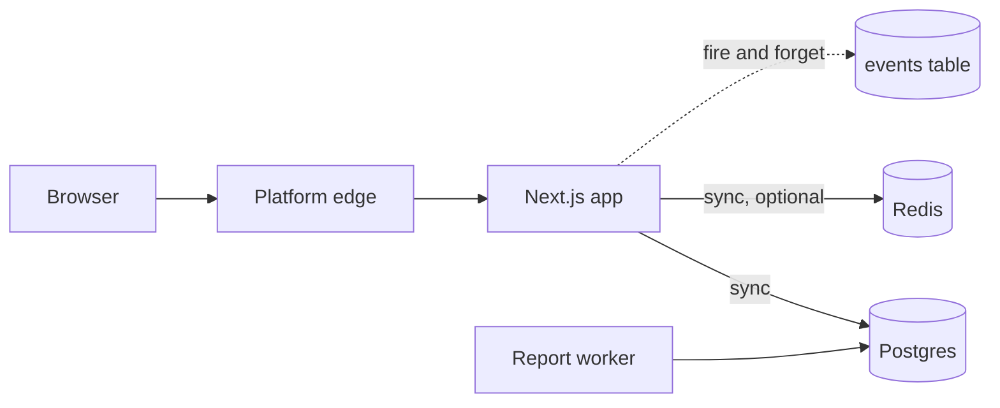

<Section kind="story">

A founder hired a contract engineer for two weeks of backend work. In the kickoff call she said: *"The server sends the data to the API, which saves it in the backend."*

The engineer nodded and built something reasonable. It wasn't what she wanted. She had meant: the browser posts to an endpoint, which writes to the database. He had heard: a background service pushes data to a third-party API, which persists it somewhere. Both readings fit her sentence. Nobody noticed for nine days.

The money wasn't lost to a technical mistake. It was lost because three words — "server", "API", "backend" — each had two meanings in the room, and no one knew they were ambiguous.

This is the least glamorous lesson in the program and one of the highest-leverage. Precise words are how you get precise work out of an engineer, a vendor, or an <Term k="api">AI agent</Term>. Vague words get you confident output that solves a different problem.

</Section>

<Section kind="already-did">

Your agent has written all of these words in comments and commit messages you approved: *middleware*, *endpoint*, *service*, *worker*, *client*, *job*, *handler*. You have deployed things called a "web service" and a "background worker" on Railway or Render by picking from a dropdown. You've seen a Vercel build log distinguish "static" from "serverless function".

You already operate the concepts. What you may not have is a reliable mapping from each word to exactly one box on the diagram from L0.1 — which means when an agent says "I moved that into a service", you can't tell whether a new deployable just appeared in your architecture or a file got renamed.

</Section>

<Section kind="mental-model">

There are only two kinds of things on an architecture diagram: **boxes** (something that runs or stores) and **arrows** (something that talks to something else). Every piece of jargon is one of those two things viewed from a particular angle.

<svg viewBox="0 0 780 330" role="img" aria-label="Architecture vocabulary: client talks to an edge proxy, which routes to an app server; the app reads and writes a database, a cache and object storage, and pushes jobs onto a queue that a worker consumes" className="diagram">
  <defs>
    <marker id="arrv" viewBox="0 0 10 10" refX="9" refY="5" markerWidth="7" markerHeight="7" orient="auto-start-reverse">
      <path d="M 0 0 L 10 5 L 0 10 z" className="arrowhead" />
    </marker>
  </defs>

  <rect x="8" y="110" width="150" height="58" rx="10" />
  <text x="83" y="134" textAnchor="middle">Client</text>
  <text x="83" y="153" textAnchor="middle" className="sub">browser · mobile app</text>

  <rect x="196" y="110" width="150" height="58" rx="10" />
  <text x="271" y="134" textAnchor="middle">Proxy / edge</text>
  <text x="271" y="153" textAnchor="middle" className="sub">CDN · load balancer</text>

  <rect x="384" y="110" width="150" height="58" rx="10" />
  <text x="459" y="134" textAnchor="middle">App server</text>
  <text x="459" y="153" textAnchor="middle" className="sub">your endpoints run here</text>

  <rect x="604" y="14" width="160" height="52" rx="10" />
  <text x="684" y="36" textAnchor="middle">Cache</text>
  <text x="684" y="54" textAnchor="middle" className="sub">Redis — fast, disposable</text>

  <rect x="604" y="84" width="160" height="52" rx="10" />
  <text x="684" y="106" textAnchor="middle">Database</text>
  <text x="684" y="124" textAnchor="middle" className="sub">Postgres — the truth</text>

  <rect x="604" y="154" width="160" height="52" rx="10" />
  <text x="684" y="176" textAnchor="middle">Object storage</text>
  <text x="684" y="194" textAnchor="middle" className="sub">S3 — files by URL</text>

  <rect x="384" y="244" width="150" height="58" rx="10" />
  <text x="459" y="268" textAnchor="middle">Queue</text>
  <text x="459" y="287" textAnchor="middle" className="sub">pending work</text>

  <rect x="604" y="244" width="160" height="58" rx="10" />
  <text x="684" y="268" textAnchor="middle">Worker</text>
  <text x="684" y="287" textAnchor="middle" className="sub">runs jobs off the queue</text>

  <path d="M 158 139 L 192 139" className="arrow" markerEnd="url(#arrv)" />
  <path d="M 346 139 L 380 139" className="arrow" markerEnd="url(#arrv)" />
  <path d="M 534 130 L 570 110 L 600 48" className="arrow" markerEnd="url(#arrv)" />
  <path d="M 534 139 L 600 110" className="arrow" markerEnd="url(#arrv)" />
  <path d="M 534 148 L 570 168 L 600 180" className="arrow" markerEnd="url(#arrv)" />
  <path d="M 459 168 L 459 240" className="arrow" markerEnd="url(#arrv)" />
  <path d="M 534 273 L 600 273" className="arrow" markerEnd="url(#arrv)" />
  <path d="M 684 240 L 684 212" className="arrow" markerEnd="url(#arrv)" />
  <text x="12" y="208" className="sub">Arrows are requests. Each one can be slow, fail, or be retried.</text>
  <text x="12" y="226" className="sub">Boxes are things that run or store. Each one can be down.</text>
</svg>

### The boxes

| Word | What it is on the diagram | The ambiguity to avoid |
|---|---|---|
| **Client** | Whatever starts a request — browser, mobile app, another server calling you | "Client" also means *customer*. Say "the browser" when you mean the browser. |
| **Server** | A machine or process that answers requests | Means both *the hardware* and *your running app*. Say "app server" or "the box". |
| **App / backend** | Your code that handles requests | "Backend" is used for *your server code*, *the database*, and *a third-party vendor*. Name the box instead. |
| **Endpoint** | One callable URL + method on your app (`POST /api/bookings`) | Precise and useful — prefer it over "the API". |
| **<Term k="api">API</Term>** | The whole set of endpoints, or someone else's service | Always say *whose*: "our API" vs "Stripe's API". |
| **Service** | A separately deployable process with its own lifecycle | Often misused for "a file of related functions". Ask: *does it deploy on its own?* |
| **<Term k="reverse-proxy">Proxy</Term>** | Sits in front and forwards requests (Nginx, platform edge) | — |
| **<Term k="cdn">CDN</Term>** | Geographically distributed cache for static content | — |
| **Database** | Durable, authoritative storage | "The DB is slow" usually means *one query* is slow. |
| **<Term k="cache">Cache</Term>** | A fast, disposable copy | Losing it must be survivable; if it isn't, it's a database. |
| **<Term k="object-storage">Object storage</Term>** | Files addressed by key, served by URL | Not a filesystem; not for structured data. |
| **<Term k="queue">Queue</Term>** | A durable list of work waiting to be done | — |
| **<Term k="worker">Worker</Term>** | A process that takes jobs off a queue and runs them | Sometimes called "consumer", "job runner", or "background service". |
| **Cron / scheduled job** | Something that runs on a clock, not on a request | — |

### The arrows

Arrows are where most production pain lives, and they have properties worth naming:

- **Synchronous** — the caller waits for the answer. Browser → app, app → database. If the callee is slow, the caller is slow. A user is watching.
- **Asynchronous** — the caller hands off and moves on. App → queue → worker. Slowness becomes a *backlog*, not a timeout.
- **Inbound vs outbound** — someone calling you (you can't control the volume) versus you calling someone (you can't control the latency, and they may rate-limit you).
- **Crosses a trust boundary?** — browser → app crosses from untrusted to trusted; every value must be validated. App → your own database doesn't.
- **Crosses a network?** — app → database over a local socket is microseconds; across a <Term k="region">region</Term> is tens of milliseconds, every single query.

<Callout type="key">
When you describe a change, name a box and an arrow: *"the booking endpoint on the app server writes to Postgres synchronously; I want it to push a job on the queue instead, and the worker sends the email."* That sentence cannot be misread. "Make booking emails async" can be built four different ways.
</Callout>

### The test that resolves most arguments

Two questions settle whether something deserves its own box:

1. **Can it fail independently?** If Redis dies and your app keeps serving, they're separate boxes.
2. **Does it deploy independently?** If you can ship the worker without rebuilding the web app, they're separate boxes.

A folder named `services/` with no separate deployment is not a service. It's a folder. That distinction decides whether "split out the payment service" is an afternoon or a month.

<Operator>

The vocabulary has an operational payoff: each box type is inspected differently, and knowing the word tells you the command.

```bash
# Which boxes actually exist in this system right now?
docker compose ps                     # local/compose: one line per box
#   Platform equivalent: the services list in your Railway/Render dashboard

# Is this box a web service or a worker? Look at what it listens on.
docker compose exec app sh -c 'netstat -tln 2>/dev/null || ss -tln'
#   A web service listens on a port. A worker listens on nothing — it dials out.

# Which arrows does a box actually use? Read its environment, not the docs.
docker compose exec app env | grep -iE "url|host|key" | sed 's/=.*/=<redacted>/'
#   DATABASE_URL, REDIS_URL → the arrows this box draws. Nothing else is reachable.

# Prove an arrow works, independent of the app's code:
docker compose exec app sh -c 'nc -zv db 5432; nc -zv cache 6379'

# Is this arrow synchronous? Time it from inside the box.
docker compose exec db psql -U ots -d demo -c '\timing' -c 'SELECT count(*) FROM bookings;'
```

The `env | grep url` trick is the fastest architecture discovery there is: a process can only draw arrows to things it has an address for.

</Operator>

</Section>

<Section kind="tools">

Diagramming tools, judged on whether anyone will keep them current — an out-of-date diagram is worse than none, because people trust it.

| Tool | Good for | Cost of upkeep |
|---|---|---|
| Pen and paper / whiteboard photo | The first version, in 10 minutes | None, and nobody will update it |
| Mermaid in your repo (`.md`) | Diagrams that live next to code and change in PRs | Low — it's text, so it diffs and reviews |
| Excalidraw / tldraw | Explaining to humans; deliberately sketchy | Medium |
| Lucidchart / Miro | Formal diagrams for stakeholders | High; usually abandoned |
| Auto-generated (platform topology, `terraform graph`) | Verifying the diagram matches reality | None, but it shows *infrastructure*, not intent |

The opinionated recommendation: **Mermaid, in the repo, in your README.** It renders on GitHub, it's text so an agent can update it in a PR, and reviewers notice when a change adds a box without updating it.



Note what the arrow labels carry: `sync`, `optional`, `fire and forget`. That's the information that makes a diagram useful during an incident.

</Section>

<Section kind="hands-on">

Reverse-engineer the demo app's architecture using only the techniques above — no peeking at its README.

```bash
cd demo-app
docker compose ps                                   # how many boxes?
docker compose exec app env | grep -iE "url" | sed 's/=.*/=…/'
docker compose exec worker env | grep -iE "url" | sed 's/=.*/=…/'
```

Then answer, in writing:

1. How many **boxes** does this system have, and which are web services vs workers? (Hint: one of them listens on no port.)
2. Which **arrows** exist? For each, is it synchronous or asynchronous, and does it cross a trust boundary?
3. The worker and the app both talk to Postgres. Does the worker talk to Redis? How do you know *without reading the code*?
4. Draw it as Mermaid, with `sync`/`async`/`optional` on each arrow. Paste it into a scratch `.md` file and check it renders.
5. Now open `demo-app/README.md` and compare. Anything you missed is a thing you'd also miss on your own product.

Keep this diagram — L0.3 builds your *own* product's map using exactly this method.

</Section>

<Section kind="break-fix">

**Symptom:** you asked your agent to "make the report generation async so the admin page isn't slow". It reported success: *"Moved report generation to a background job. The admin page now returns immediately."* The admin page is indeed fast. Two days later, nobody has received a report, and nothing is in the logs.

<Evidence title="what the agent changed (diff summary)">

```text
app/api/reports/route.ts
+  // Fire and forget so the request returns immediately
+  void generateReport(day)      // was: await generateReport(day)
   return NextResponse.json({ status: "generating" })

lib/reports.ts
   export async function generateReport(day: string) {
     const rows = await db.query(/* heavy aggregate */)
     await db.query(`INSERT INTO reports (day, body) VALUES ($1, $2)`, [day, body])
+    console.log(`report written for ${day}`)
   }
```

</Evidence>

<Evidence title="production reality">

```text
Platform:  Vercel (serverless functions), 1 project, 0 workers configured
Logs:      "report written for …"  — 0 occurrences in 48h
reports:   SELECT count(*) FROM reports WHERE generated_at > now() - interval '2 days';
            count
            -----
                0
Admin page: responds in 40ms with {"status":"generating"}
```

</Evidence>

The agent's sentence used the right words. Which box was supposed to appear, and did it?

<Reveal label="Reveal the cause">

**No box was added.** "Async" was implemented as *fire and forget inside the same request* — dropping the `await`. On a serverless platform the function is frozen or destroyed the moment it returns a response, so the work that was no longer awaited simply never ran to completion. The page got fast because the work stopped happening.

Map it onto the vocabulary. Making something genuinely asynchronous requires **two new boxes and two new arrows**: the app pushes a job onto a *queue*, and a *worker* (a separately deployed, long-running process) consumes it. The diff added neither. There is no queue, there is no worker, and on this platform there isn't even a process that outlives the response.

**Why it was so convincing:** every word in the agent's summary was true of the diff ("moved to a background job", "returns immediately"). The sentence described an architecture; the code described a control-flow change. You catch this by asking for boxes and arrows, not outcomes.

**The cause-level fix:** choose one — a queue plus a worker service (BullMQ on Redis, or a platform queue, with the worker deployed as its own long-running service); or a scheduled job that generates reports on a cron (the demo app's `worker/cron.js` does exactly this); or keep it synchronous and make the query fast. Each is a different diagram, and D7 in the decision library compares them. What you cannot do is get asynchrony without a box that outlives the request.

**The lesson in one line:** "make it async" is not a code change, it's an architecture change — and architecture changes are visible as new boxes on the map.

</Reveal>

</Section>

<Section kind="ask-agent">

<AgentTask prompt={"Describe the architecture of this repository as a Mermaid flowchart. Rules: one node per independently deployable process or managed service, nothing else. Label each arrow sync or async, and mark which arrows cross a trust boundary. List any node you inferred from code rather than from configuration, and say which file told you."}>
Check the node count against reality — `docker compose ps`, or your platform's service list. An agent will often promote a folder to a node. Ask "does this deploy independently?" for anything you don't recognise, and make it cite the config file that proves each box exists.
</AgentTask>

<AgentTask prompt={"I want [outcome, e.g. 'booking confirmation emails sent without slowing the request']. Give me two or three architectures that achieve it, each expressed as the boxes and arrows that must exist, and what each one costs me in new infrastructure to run and monitor. Don't write code yet."}>
The deliverable is a comparison of diagrams, not a diff. Count the new boxes in each option: every box is something that can be down at 3am and that you now have to monitor. If an option claims zero new boxes for an async outcome, it is the fire-and-forget trap from the break-fix.
</AgentTask>

<AgentTask prompt={"Review this change and tell me, in box-and-arrow terms, what it does to my architecture: does it add, remove or re-point any box or arrow? If it only changes code inside one existing box, say exactly that."}>
Run this on any PR that sounds architectural. "Only changes code inside the app server box" is a perfectly good answer and tells you the risk is contained. A change that re-points an arrow (new database, new provider) deserves far more scrutiny than its diff size suggests.
</AgentTask>

</Section>

<Section kind="checklist">

Questions that force precision — use them on agents, contractors and vendors:

- "Which box does that run in?" (If the answer is "the backend", ask again.)
- "Does that deploy independently of the web app?" (Service or folder?)
- "Is that arrow synchronous? What does the user see if the other side is slow?"
- "What happens to in-flight work if that box restarts mid-request?"
- "Which box holds the only copy of this data?" (That's your database, whatever it's called.)
- "Does this change add a box, remove one, or re-point an arrow?"

What good looks like: your repo README contains a current Mermaid diagram, arrows labelled sync/async, and a PR that adds a box also updates that diagram. Your team's words map one-to-one onto its boxes.

Red flag: the words "server", "backend" and "API" doing heavy lifting in the same sentence. That's the nine-lost-days sentence from the story.

</Section>

<Section kind="check">

<Quiz
  lessonId="m00-l02"
  questions={[
    {
      q: "Your agent says it \"extracted the payment logic into its own service\". What single question determines whether a new box just appeared on your architecture diagram?",
      options: [
        "How many files did it create?",
        "Does it deploy and fail independently of the web app?",
        "Does it have its own folder and tests?",
        "Is the code in TypeScript or JavaScript?"
      ],
      answer: 1,
      explain: "Independent deployment and independent failure are what make something a box. A folder named services/ that ships inside the same deployable is organisation, not architecture — and the difference decides whether this was an afternoon or a month."
    },
    {
      q: "What is the practical difference between a cache and a database, in box-and-arrow terms?",
      options: [
        "The cache is faster; otherwise they're interchangeable",
        "Losing the cache must be survivable — if losing it loses data, it is a database no matter what product it is",
        "Caches hold strings, databases hold structured records",
        "The database is synchronous and the cache is asynchronous"
      ],
      answer: 1,
      explain: "The definition is about consequence, not product. Teams get burned by storing session state or the only copy of a counter in Redis and then discovering a restart was a data-loss event."
    },
    {
      q: "Why is \"fire and forget inside the request\" not the same as making work asynchronous?",
      options: [
        "It is the same thing, just with less tooling",
        "Genuine asynchrony needs a box that outlives the request — a queue plus a worker; otherwise the work dies with the response, especially on serverless",
        "Fire and forget is slower because the event loop blocks",
        "It only works for database writes, not for sending email"
      ],
      answer: 1,
      explain: "That was exactly the break-fix: the page got fast because the work stopped happening. Async requires new boxes (queue, worker), and on serverless the function is frozen the moment it responds."
    },
    {
      q: "Which property of an arrow most changes what a user experiences when the far side is slow?",
      options: [
        "Whether it crosses a trust boundary",
        "Whether it is synchronous — a waiting user absorbs the latency; an async arrow turns slowness into a backlog",
        "Whether it uses HTTP or a database protocol",
        "Whether it is inbound or outbound"
      ],
      answer: 1,
      explain: "Synchronous slowness propagates straight to the person watching the spinner, and eventually becomes a 504. Asynchronous slowness becomes a growing queue — bad, but not user-facing in the same moment."
    },
    {
      q: "Without reading any application code, how do you discover which arrows a running process can draw?",
      options: [
        "Read the README",
        "Inspect its environment variables and configuration — a process can only reach things it has an address for",
        "Check which ports it listens on",
        "Look at the git history for new dependencies"
      ],
      answer: 1,
      explain: "`env | grep -i url` is the fastest architecture discovery available. Listening ports tell you about inbound arrows (is it a web service or a worker); addresses in config tell you about outbound ones."
    }
  ]}
/>

</Section>
