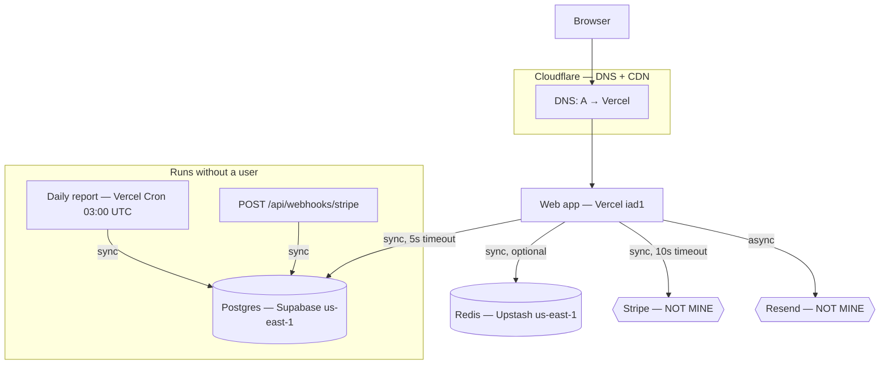

<Section kind="story">

Two founders, same incident, different outcomes.

The first gets paged: checkout is failing. He opens his laptop and starts reading code, because code is what he knows. Forty minutes in, he's read three files that turn out to be irrelevant, asked his agent four questions, and shipped two speculative fixes.

The second gets the same page. She opens a diagram — one page, eleven boxes, provider names on each, pinned in her repo's README. Checkout touches five of those boxes. She checks the two she doesn't own first, because they're the cheapest to rule out: Stripe's status page (green) and her database provider's status page (**degraded performance in us-east-1**, posted nine minutes ago). Total elapsed: ninety seconds. She has nothing to fix, so she posts a status update and waits.

Neither founder is a better engineer. One had a map.

Notice what the map gave her: not an answer, but an **ordered list of candidates**. That's what a map is for.

</Section>

<Section kind="already-did">

You have already drawn this diagram — badly, in fragments, several times. It exists scattered across: the services list in your platform dashboard, your `.env` file, the connection strings in your password manager, your monthly credit card statement, and the "architecture" paragraph your agent wrote in your README six months and four pivots ago.

The pieces are all there. What's missing is one page where they sit together, so that "which of my eleven boxes could cause this symptom?" is a question you can answer by *looking* instead of *remembering*.

This lesson is the single highest-return 45 minutes in the program. Everything after it is a zoom into one box of a map you'll have drawn yourself.

</Section>

<Section kind="mental-model">

A good architecture map is not a beautiful diagram. It's an **incident instrument**. Judge it by one standard: at 3am, with a vague symptom, does it give you an ordered list of places to look?

That standard implies four things most diagrams get wrong.

### 1. Every box carries its provider and where to look

A box labelled "Database" is decoration. A box labelled **"Postgres — Supabase, project `prod-rs`, us-east-1 → dashboard link"** is an instrument. During an incident you need the provider (to check their status page), the region (to correlate with their outage notices), and the place you click.

### 2. Boxes you don't own get marked

Your code can't be the cause of Stripe being down, and no amount of reading your repo will reveal it. Third-party boxes are the **cheapest to rule out** — a status page is five seconds — so mark them and check them first. Draw them with a dashed border, a different colour, whatever you like, as long as you can see at a glance which boxes you cannot fix.

### 3. Arrows carry what breaks when they're slow

`sync` vs `async`, and whether there's a timeout. An arrow with no timeout is a documented way for someone else's outage to become your outage.

### 4. It includes the things that aren't requests

The box most often missing from hand-drawn maps is the one that runs on a clock. Cron jobs, scheduled functions, webhook receivers, batch imports — they touch your data without any user triggering them, which is exactly why their failures are discovered late. If your map only shows the request path, you have mapped the part of your system that complains loudly and omitted the part that fails silently.

<Callout type="key">
The question that finds your missing boxes: **"what else writes to my database?"** Not what serves pages — what *writes*. Cron jobs, webhook handlers, admin scripts, your own `psql` session, a Retool dashboard, a Zapier automation. Each one is a box, and each one can corrupt data while every request-path graph stays green.
</Callout>

### The five questions that produce the map

Work through these in order. Each one is answerable from a dashboard or a file — none require remembering.

| # | Question | Where the answer is |
|---|----------|---------------------|
| 1 | What does a user's request touch, in order? | The L0.1 chain, applied to your product |
| 2 | What holds data? | Your `.env` connection strings; your provider bills |
| 3 | What runs without a user? | Cron config, scheduled functions, webhook endpoints, queue consumers |
| 4 | What do I call that I don't own? | Outbound API keys in your env; your vendor invoices |
| 5 | What's in front of it all? | Your DNS records and CDN settings |

Question 2 has a reliable shortcut most people haven't tried: **read your bills.** Every box that costs money appears on a statement. A $7 line item you don't recognise is a box missing from your map — and quite possibly one nobody is monitoring.

<Operator>

Harvest the map from your actual configuration rather than memory. Each command produces boxes or arrows.

```bash
# --- Boxes you deploy: what's running? ---
#   PaaS: the services list is the answer. CLI versions:
vercel project ls                 # Vercel
railway status                    # Railway
flyctl apps list                  # Fly
#   VPS:
systemctl list-units --type=service --state=running | grep -vE "^(systemd|dbus|cron|ssh)"
docker ps --format "table {{.Names}}\t{{.Image}}\t{{.Ports}}"

# --- Arrows: what addresses does my code hold? ---
#   Every outbound arrow needs an address or a key. Find them all:
grep -rhoE "[A-Z_]+(_URL|_HOST|_KEY|_TOKEN|_SECRET|_DSN)" --include="*.ts" --include="*.js" \
  --include="*.py" . 2>/dev/null | sort -u
#   Then list what prod actually sets (names only, never values):
vercel env ls                     # or your platform's env page

# --- Boxes that run on a clock (the ones people forget) ---
crontab -l 2>/dev/null
ls -la /etc/cron.d/ 2>/dev/null
cat vercel.json 2>/dev/null | python3 -c "import json,sys; print(json.load(sys.stdin).get('crons'))" 2>/dev/null
grep -rn "schedule:" .github/workflows/ 2>/dev/null
#   Postgres-side schedulers hide here:
#   SELECT * FROM cron.job;        -- pg_cron
#   Supabase: Database → Cron / Edge Function schedules

# --- Inbound arrows you didn't initiate: webhook receivers ---
grep -rln "webhook" --include="*.ts" --include="*.js" app/ src/ pages/ 2>/dev/null

# --- DNS: what's in front of everything ---
dig +short yourapp.com; dig +short yourapp.com NS
```

Run the `grep` for `_URL|_KEY|_TOKEN` on your own repo before reading further. Most people find at least one integration they'd forgotten they wired up.

</Operator>

</Section>

<Section kind="tools">

| Approach | Use it when | Honest downside |
|---|---|---|
| **Mermaid in your README** | Default choice — text, diffs in PRs, renders on GitHub | Layout control is limited; large graphs get ugly |
| Excalidraw, exported PNG + source in repo | You want a diagram humans enjoy reading | Nobody updates it after month two |
| A plain Markdown table of boxes | You hate diagrams and want the instrument anyway | Loses the arrows, which is half the value |
| Platform topology view (Railway, Render) | Verifying you didn't forget a deployed service | Shows only that platform's boxes — misses third parties and DNS |
| Terraform / IaC graph | You already manage infra as code | Shows declared infrastructure, not intent or third parties |

A plain table genuinely works, and is better than no map:

| Box | Provider | Region | Where I look | Mine? |
|---|---|---|---|---|
| Web app | Vercel | iad1 | Deployments → Logs | ✅ |
| Postgres | Supabase `prod-rs` | us-east-1 | Dashboard → Logs | ✅ |
| Redis | Upstash | us-east-1 | Console → Metrics | ✅ |
| Report worker | Render (background) | Oregon | Service → Logs | ✅ |
| Payments | Stripe | — | status.stripe.com | ❌ |
| Email | Resend | — | Dashboard → Logs | ❌ |
| LLM | Anthropic | — | status.anthropic.com | ❌ |
| DNS + CDN | Cloudflare | — | Dashboard → DNS | ✅ |

Note the mix of regions in rows 2–4: that's the kind of thing a map makes visible and memory doesn't. A worker in Oregon talking to a database in Virginia pays ~70ms per query, forever.

</Section>

<Section kind="hands-on">

**This is the exercise the module exists for.** Budget 45 minutes. Use a real product you shipped — not a hypothetical one.

**Step 1 — Harvest (15 min).** Work the five questions. Open your platform dashboard, your `.env`, your DNS provider, and last month's bills. Write a flat list of every box with its provider, region and dashboard link. Don't draw yet; don't filter.

**Step 2 — Mark what you don't own (2 min).** Go down the list and put ❌ on every box you cannot fix. These are your first-to-check during incidents.

**Step 3 — Draw it (15 min).** Mermaid in your repo's README, or the table above. Minimum requirements: provider on every box, `sync`/`async` on every arrow, third parties visually distinct, and a section for clock-driven boxes.



**Step 4 — Stress-test it (10 min).** Your map is only an instrument if it answers questions. Take these four symptoms and, using *only* the diagram, write the ordered list of boxes you'd check:

1. "Checkout fails for everyone."
2. "The site is slow, but only for users in Europe."
3. "A customer says they were charged twice."
4. "Last night's report never arrived."

If any symptom leaves you with "I don't know where to look", your map has a gap. Symptom 4 in particular tends to expose a missing clock-driven box.

**Step 5 — Commit it.** Into the repo, in the README. A map in a Figma file nobody opens during an incident is not an instrument.

Then: **revisit this map after every module.** M5 will make you add detail to your edge boxes, M6 to your data boxes, M7 to your clock boxes, M9 to your arrows. The map is the spine of the whole program, and the version you have at the end should look nothing like today's.

</Section>

<Section kind="break-fix">

**Symptom:** A SaaS founder's customers report that their weekly digest emails stopped arriving. No errors in the app. The app's dashboards are green. His map — drawn carefully six weeks ago — is below, along with what he finds.

<Evidence title="his architecture map (as committed)">

```text
Browser → Cloudflare (DNS+CDN) → Web app (Render, Oregon)
Web app → Postgres (Neon, us-west-2)   [sync]
Web app → Resend (email)               [sync, NOT MINE]
Web app → Stripe                       [sync, NOT MINE]
```

</Evidence>

<Evidence title="what he checks">

```text
status.resend.com         → all systems operational
Resend dashboard → Logs   → last email sent 9 days ago (a password reset)
Web app logs (7d)         → no errors, no "digest" log lines at all
Postgres                  → SELECT max(sent_at) FROM digest_sends;
                            2026-10-28 03:00:04+00     (9 days ago)
Render dashboard          → 1 service: "web" (Running)
Render billing (last month) → Web service          $25.00
                              Cron job "digests"   $1.40
                              ———
                            (this month) Web service $25.00
```

</Evidence>

The digest has not run for nine days. Where does his map fail him, and what's the actual cause?

<Reveal label="Reveal the cause">

**The map has no clock-driven box.** The weekly digest runs as a Render **cron job** — a separate deployable that the map never showed, because the map was drawn by tracing a user request. No request reaches a cron job, so tracing requests cannot find one. The `digest_sends` table stops 9 days ago, the Resend log agrees, and the app logs contain *nothing* about digests — because the code that sends them has never run inside the web service.

**The cause is on the bill.** Last month lists a `Cron job "digests"` line at $1.40; this month doesn't. The cron service is gone — suspended, deleted, or failed to redeploy, and that's the next thing to check in the Render dashboard with "show deleted/suspended services" enabled. That `$1.40` line is the single most informative artefact in the entire evidence set, and it only became visible because he looked at the bill.

**Why nine days of silence:** nothing watches a job that doesn't run. The web app can't log an error for code it never executes; Resend can't report a failure for an email nobody asked it to send; `digest_sends` can't contain a row for a run that never started. **Absence produces no signal.** The only reliable countermeasure is a <Term k="dead-mans-switch">dead man's switch</Term>: the job pings a monitor on success, and the monitor alerts when pings *stop*. (M7.8 builds exactly this; failure catalogue entry "cron job silently stopped" is the reference card.)

**The fix, in order:** restore or redeploy the cron service and confirm it runs; backfill the nine missed digests, deliberately and once (there's an idempotency question there — M7.7); add the dead man's switch; then **add the box to the map** with a note that it runs at 03:00 Mondays. The map change is the part that prevents the recurrence, which is why it belongs in the fix and not in a backlog.

</Reveal>

</Section>

<Section kind="ask-agent">

<AgentTask prompt={"Scan this repository and list every box in my architecture, in four groups: (1) things I deploy, (2) data stores, (3) things that run on a schedule or receive webhooks — with their schedule and trigger, (4) third-party services I call. For each, cite the file and line that proves it exists. Do not infer from documentation or comments; only from configuration, code and dependency manifests."}>
Group 3 is the one you're really buying — it's what human mapping misses. Verify every item against a dashboard, and treat anything the agent could only find in a comment as unproven. Then check the reverse: anything on your bills that the agent didn't find is a box with no code pointing at it, which is its own kind of problem.
</AgentTask>

<AgentTask prompt={"Here is my architecture map: [paste it]. Act as an incident responder with only this map. For each symptom — (a) checkout fails for everyone, (b) the site is slow only in Europe, (c) a customer was charged twice, (d) last night's scheduled job didn't run — give the ordered list of boxes to check and the single cheapest check for each. If the map lacks the information you'd need, name what's missing."}>
The last sentence is the point: you want the gaps. An agent that cheerfully answers all four without complaint has likely invented detail — compare its boxes against your map and challenge anything that isn't there.
</AgentTask>

<AgentTask prompt={"Update the Mermaid diagram in README.md to include [the box you just discovered], with its provider and region, mark arrows sync or async with their timeouts, and keep third-party services visually distinct from services I own. Change nothing else in the file."}>
Read the diff, not the rendered picture: check it didn't quietly re-label existing boxes or drop arrows to make the layout tidier. Then confirm it renders — paste into a GitHub comment preview or your IDE's Mermaid preview. A diagram that doesn't render is a diagram nobody will open during an incident.
</AgentTask>

</Section>

<Section kind="checklist">

Your map is done when all of these are true:

- Every box names its **provider** and the **region** where relevant.
- Every box has a **"where I look"** link — the dashboard, log view, or status page.
- Boxes you don't own are **visually distinct**, because they're the cheapest to rule out.
- Every arrow says **sync or async**, and names a **timeout** where one exists.
- There is a section for things that run **without a user**: crons, scheduled functions, webhook receivers, queue consumers.
- Every line item on your **bill** maps to a box (and vice versa).
- It lives **in the repo**, and the last change to your infrastructure updated it.
- You can answer the four stress-test symptoms using only the diagram.

Questions to ask yourself quarterly: What writes to my database that isn't the web app? Which arrow has no timeout? Which box is in a different region from the thing it talks to most? Which box would I not notice failing for a week?

Red flag: a map drawn only by tracing a user request. That method structurally cannot find the boxes that fail silently.

</Section>

<Section kind="check">

<Quiz
  lessonId="m00-l03"
  questions={[
    {
      q: "What single standard tells you whether an architecture map is any good?",
      options: [
        "It renders cleanly and is visually consistent",
        "Given a vague symptom at 3am, it yields an ordered list of places to look",
        "It documents every file and module in the codebase",
        "An engineer unfamiliar with the product can understand the business"
      ],
      answer: 1,
      explain: "A map is an incident instrument, not documentation. Everything the lesson asks you to put on it — providers, regions, dashboard links, sync/async, ownership — exists to serve that one standard."
    },
    {
      q: "Why are third-party boxes worth marking as visually distinct?",
      options: [
        "They cost more money than services you run",
        "They are the cheapest boxes to rule out — a status page takes seconds — and no amount of reading your code can reveal their outages",
        "They are more likely to fail than your own services",
        "Compliance requires documenting data processors"
      ],
      answer: 1,
      explain: "That's the ninety-second diagnosis in the story. Ordering candidates by cost-to-check puts other people's status pages first, and your repo is useless against them."
    },
    {
      q: "Which category of box is most often missing from a hand-drawn map, and why?",
      options: [
        "The database, because it's taken for granted",
        "Clock-driven and webhook-triggered boxes, because no user request touches them — so tracing a request can't find them",
        "The CDN, because the platform hides it",
        "The frontend, because it runs on the user's machine"
      ],
      answer: 1,
      explain: "Maps get drawn by following a request, and nothing requests a cron job. That's structural: the method cannot find them, which is why the lesson adds a separate harvesting question and a separate diagram section."
    },
    {
      q: "In the break-fix, which piece of evidence most directly identified the cause?",
      options: [
        "The Resend dashboard showing no recent sends",
        "Last month's bill listing a cron job line item that this month's bill doesn't",
        "The absence of digest lines in the web app logs",
        "status.resend.com reporting all systems operational"
      ],
      answer: 1,
      explain: "The bill proved a box existed and has stopped being billed. The other three pieces all confirm the digest isn't happening but can't say why — absence of a thing produces no signal from the thing itself."
    },
    {
      q: "A job that fails to run produces no logs, no errors, and no rows. What monitoring approach actually catches it?",
      options: [
        "Alert when the job's error rate exceeds a threshold",
        "A dead man's switch: the job pings a monitor on success, and the monitor alerts when pings stop arriving",
        "Increase the log level on the job to debug",
        "Add a try/catch around the job body that reports to Sentry"
      ],
      answer: 1,
      explain: "Every option but the switch requires the job to run in order to tell you something. Monitoring absence means inverting it — something outside your system notices silence."
    }
  ]}
/>

</Section>
